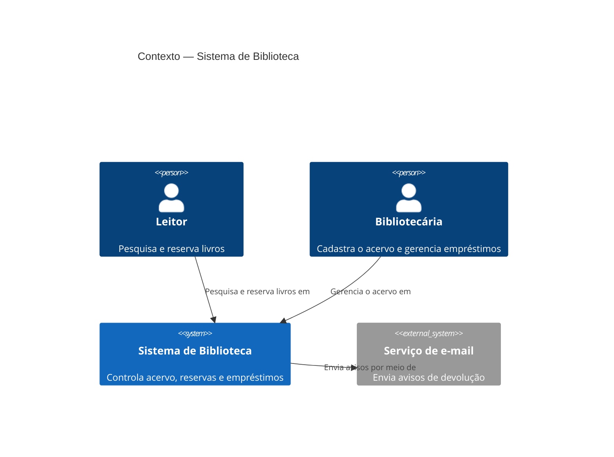
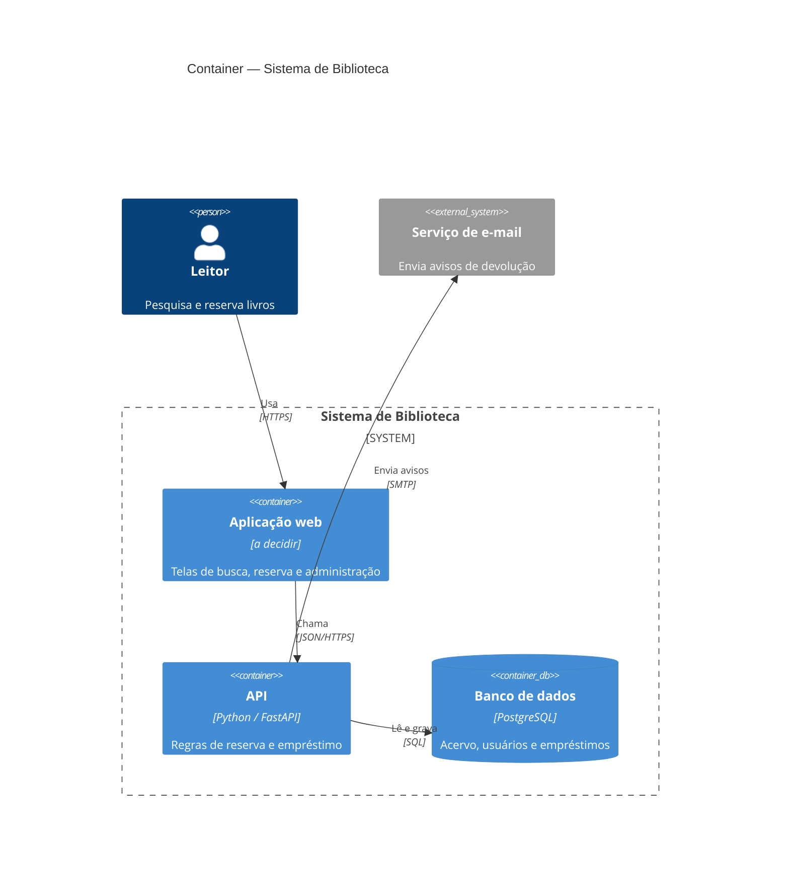

# Referência: Mermaid C4 (níveis 1 e 2)

Leia antes de escrever os diagramas. Os exemplos usam um domínio genérico (uma biblioteca). **Não copie os elementos deles**: copie só a forma.

## Nível 1: Contexto

Elementos permitidos: `Person`, `Person_Ext`, `System`, `System_Ext`, `SystemDb_Ext`, `Rel`, `BiRel`.

## Nível 2: Container

Elementos permitidos: os do nível 1, mais `System_Boundary`, `Container`, `ContainerDb`, `ContainerQueue`, `Container_Ext`, `ContainerDb_Ext`.

Assinaturas:
- `Person(alias, rótulo, descrição)`
- `System(alias, rótulo, descrição)`
- `Container(alias, rótulo, tecnologia, descrição)`
- `Rel(origem, destino, rótulo, tecnologia opcional)`

## Erros comuns

- **Classe ou módulo como container.** "ParserDeCatálogo" dentro da API é um componente (nível 3), não um container.
- **Biblioteca como container.** Uma biblioteca de leitura de PDF é copiada para dentro da aplicação; ela não roda sozinha.
- **Relação sem verbo.** Escreva "Lê preços de", não só "Usa" sem contexto.
- **Tecnologia no nível 1.** No Contexto não aparece "PostgreSQL" nem "React".
- **Alias com acento ou espaço.** Use `gestora`, `api_catalogos`. Os acentos ficam só nos rótulos entre aspas.
- **Layout poluído.** Mais de 8 a 10 elementos em um diagrama é sinal de que o nível está errado.
