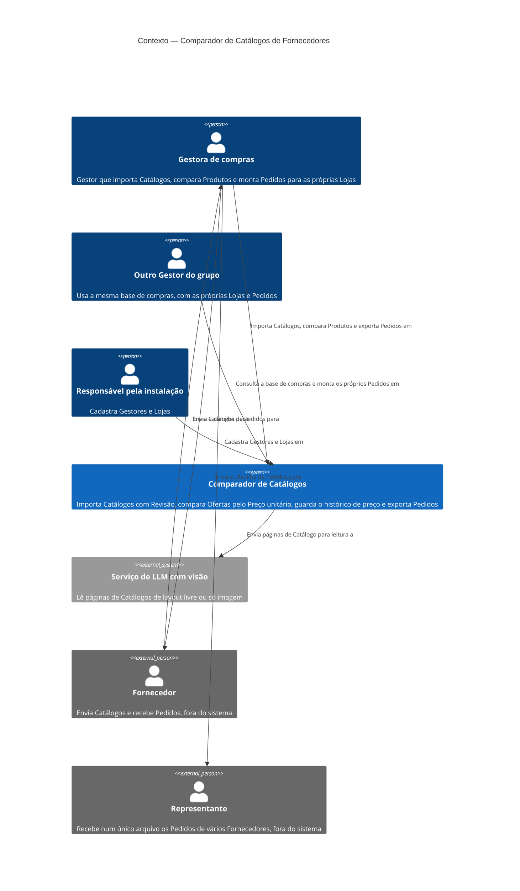

# C4 — Nível 1: Contexto

Arquitetura **planejada** do MVP, derivada de [spec](../spec.md), [GLOSSARY](../../GLOSSARY.md) e [ADRs](../adr/). Ainda não existe código.

## Elementos

| Nome | Tipo | Responsabilidade | Origem |
|---|---|---|---|
| Gestora de compras | Pessoa | Importa Catálogos, faz a Revisão, liga Ofertas a Produtos, compara, monta e exporta Pedidos | Spec, histórias 1–97; Briefing §1 |
| Outro Gestor do grupo | Pessoa | Usa a base de compras comum; tem as próprias Lojas e Pedidos | ADR-0007; spec, histórias 98–100 |
| Responsável pela instalação | Pessoa | Cadastra Gestores e Lojas; não há autocadastro | Spec, história 6 |
| Comparador de Catálogos | Sistema | Importação e Revisão, Preço unitário, Teto de compra, Produtos, histórico de preço, Pedidos, exportação e Painéis | Spec, Solution |
| Serviço de LLM com visão | Sistema externo | Propõe Ofertas a partir de imagens de páginas | ADR-0006; ADR-0008 |
| Fornecedor | Pessoa externa | Origem dos Catálogos e destino dos Pedidos; não usa o sistema | GLOSSARY; ADR-0004 |
| Representante | Pessoa externa | Recebe Pedidos de vários Fornecedores num único arquivo; não usa o sistema | GLOSSARY; ADR-0004 |

## Suposições e pontos inferidos

- **Inferido:** o Responsável pela instalação é um papel separado da Gestora de compras. Na prática, pode ser a própria desenvolvedora.
- Catálogos chegam à gestora fora do sistema (e-mail, mensagem) e entram por envio de arquivo. O sistema não recebe nada direto do Fornecedor.
- A planilha de Pedidos sai do sistema como arquivo, e a gestora a envia por fora (ADR-0004: não existe "envio" no sistema).
- Fornecedor e Representante aparecem como pessoas externas, embora sejam empresas, para mostrar de onde vêm os Catálogos e para onde vão os Pedidos.

## Perguntas em aberto

- Nenhuma que bloqueie este nível.
