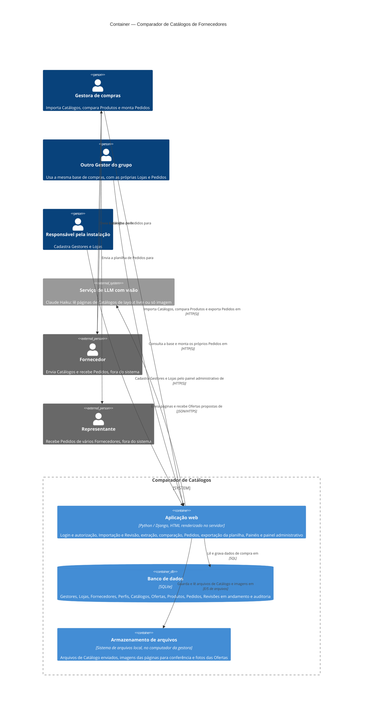

# C4 — Nível 2: Container

Arquitetura do MVP, derivada de [spec](../spec.md), [GLOSSARY](../../GLOSSARY.md) e [ADRs](../adr/). Os três containers já existem no código: a Aplicação web em Django, o banco SQLite e a pasta de arquivos (ticket 11). Parte das responsabilidades listadas ainda é planejada, e a leitura pela LLM ainda não foi implementada.

## Elementos

| Nome | Tipo | Tecnologia | Responsabilidade | Origem |
|---|---|---|---|---|
| Aplicação web | Container | Python / Django | Telas, login e autorização por Gestor, casos de uso de Importação, Revisão, Produtos, Pedidos e Painéis; extração por três caminhos; geração da planilha de Pedidos; painel administrativo | ADR-0008; ADR-0006; ADR-0004; ADR-0007; spec, histórias 1–100 |
| Banco de dados | Container (banco) | SQLite | Persistência da base de compras do grupo, das Lojas e Pedidos de cada Gestor, das Revisões em andamento e da auditoria de Perfil, Conteúdo e vínculos | ADR-0008; ADR-0007; spec, Modelo de dados |
| Armazenamento de arquivos | Container (arquivos) | sistema de arquivos local, no computador da gestora (ticket 11) | Arquivo de origem de cada Catálogo, imagens de página para a conferência da LLM e fotos | Spec (Catálogo guarda o arquivo de origem; histórias 28, 57); ADR-0011; ticket 11 |
| Serviço de LLM com visão | Sistema externo | Claude Haiku, via API | Ler páginas e propor Ofertas, sempre seguidas de Revisão | ADR-0006; ADR-0008 |
| Gestora de compras, Outro Gestor do grupo, Responsável pela instalação | Pessoas | — | Como no nível 1 | Ver [nível 1](c4-1-contexto.md) |
| Fornecedor, Representante | Pessoas externas | — | Como no nível 1; não usam o sistema | Ver [nível 1](c4-1-contexto.md) |

A disciplina pede pelo menos 3 responsabilidades distintas. Elas ficam **dentro** da Aplicação web como módulos (Contas, Catálogos, Extração, Importação e Revisão, Produtos, Pedidos, Painéis; ver o spec). São componentes do nível 3 e não aparecem aqui.

## Suposições e pontos inferidos

- Os arquivos de Catálogo, as imagens de página e as fotos ficam no sistema de arquivos local do computador da gestora (o armazenamento de mídia do Django, numa pasta fora do repositório), e não dentro do banco (ADR-0011; ticket 11). O backup leva o banco e essa pasta num único arquivo.
- **Inferido:** a chamada à LLM é feita pela própria Aplicação web, durante a Importação, sem processo em segundo plano. O ADR-0008 aceita esse risco e prevê mover a leitura para segundo plano se ficar lenta.
- Login e autorização usam a autenticação do Django; não há provedor de identidade externo.
- A exportação gera um arquivo Excel baixado pelo navegador; não há serviço de e-mail no MVP.
- Itens fora do MVP (pedidos públicos entre Gestores, frete compartilhado, avisos por e-mail) não aparecem.

## Perguntas em aberto

- Catálogos de dezenas de páginas lidos pela LLM cabem no tempo de uma requisição web, ou será preciso um worker em segundo plano (novo container)? Medir no ticket da LLM.
- Quando houver um servidor para os outros Gestores: como implantar, com HTTPS. Um ADR decide nesse momento.

## Perguntas respondidas

- **Onde a aplicação roda:** no computador da gestora, atendendo só o próprio computador (127.0.0.1). Os outros Gestores só passam a usar quando houver um servidor (ticket 11).
- **Por quanto tempo guardar os arquivos:** para sempre: os arquivos de origem de cada Catálogo, as imagens de página e as fotos. A única exceção são os arquivos e as fotos de uma Revisão abandonada (ticket 11; ADR-0011).
